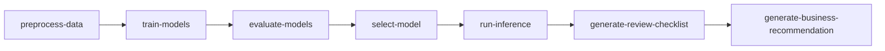
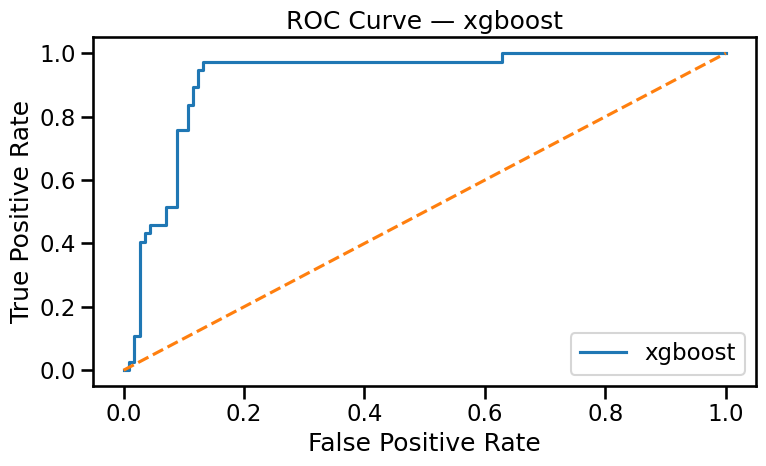
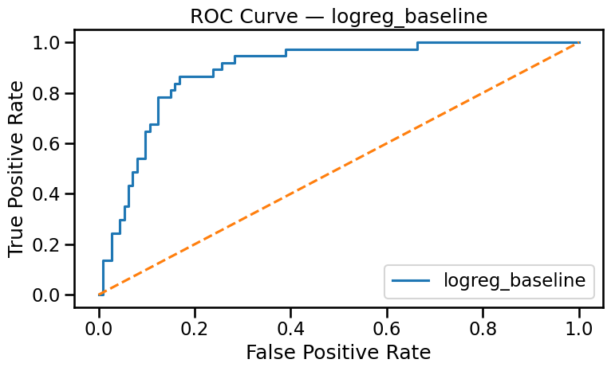

# Insurance Claims Fraud Triage — Multi-Agent Screening System

An end-to-end claims-triage prototype that combines cost-sensitive machine learning with a
multi-agent orchestration layer. The goal is not to "detect fraud" as a final verdict, but to
produce a **triage signal** that helps a claims officer decide where scarce investigation
capacity should go first.

On a held-out test set the final model reaches **cost-weighted F-beta 0.73 (β≈2.77)**,
**ROC-AUC 0.77**, **accuracy 0.80** — tuned so that missing a fraudulent claim costs much more
than double-checking a legitimate one.

## Why multi-agent?

A single model notebook answers "what is the predicted probability?". A claims workflow needs
several different judgements: how the data was prepared, which model wins and why, what a
reviewer should check first, and how to phrase all of this in business language. Each of these
is a separate skill with its own strategy file, so the pipeline is organised as **7 agent
nodes**, each backed by a versioned `SKILL.md` under [`skills/`](skills/):



| Node | Mode | Responsibility |
|------|------|----------------|
| `preprocess-data` | deterministic | Feature engineering + reproducible train/val/test splits |
| `train-models` | deterministic | Candidate models: Logistic Regression, LightGBM, XGBoost, CatBoost |
| `evaluate-models` | deterministic | Same held-out data, ROC/PR + confusion matrices |
| `select-model` | LLM-assisted | Final pick via calibrated thresholds + business trade-offs |
| `run-inference` | deterministic | Structured triage signal for a new claim |
| `generate-review-checklist` | LLM-driven | Turns raw risk output into an actionable review checklist |
| `generate-business-recommendation` | LLM-driven | Non-technical summary for claims officers |

Financial features are always computed by scripts; the LLM never does arithmetic — it only
does semantic judgement on top of deterministic outputs.

## Results

Candidate models on the validation set (n=150), scored with a cost-weighted F-beta
(β≈2.77 — a missed fraud costs ~2.8× a false alarm):

| Model | Cost-F-beta (β≈2.77) | ROC-AUC | Accuracy | Threshold |
|-------|----------------------|---------|----------|-----------|
| **CatBoost (selected)** | **0.938** | 0.915 | 0.907 | 0.30 |
| LightGBM | 0.896 | 0.920 | 0.853 | 0.10 |
| Logistic Regression | 0.685 | 0.613 | 0.300 | 0.10 |

LightGBM actually wins on raw ROC-AUC, but **CatBoost wins the cost-weighted metric at an
operationally sane threshold** (claims scoring above 0.3 get flagged for manual review) — that
trade-off is exactly what the `select-model` node is for.

Final hold-out test set (20%, untouched during selection): **F-beta 0.730 · ROC-AUC 0.770 ·
accuracy 0.800**.

| LightGBM ROC | XGBoost ROC | LogReg ROC |
|---|---|---|
|  |  |  |

## Quickstart

```bash
pip install -r requirements.txt
kaggle datasets download -d buntyshah/auto-insurance-claims-data --unzip -p data
jupyter lab notebooks/insurance_claims_triage_agent.ipynb
```

(No Kaggle account setup? Just download `insurance_claims.csv` from the dataset page
linked below and drop it into `data/`.)

The notebook is organised top-to-bottom: data prep → model training → evaluation → model
selection → inference → Gradio review UI. Pre-trained artifacts are included under `models/`
so you can jump straight to the inference / Gradio sections.

Pre-trained models are loaded automatically; retraining from scratch takes a few minutes on a
laptop. `OPENAI_API_KEY` (or any OpenAI-compatible endpoint) is only needed for the two
LLM-driven nodes at the end.

## Data

1,000 auto-insurance claims, 40 columns, ~25% fraud rate — the public
[Auto Insurance Claims Data](https://www.kaggle.com/datasets/buntyshah/auto-insurance-claims-data)
synthetic dataset (Kaggle; mirrored [here](https://www.kaggle.com/datasets/mexwell/insurance-claims)).

The repo does not ship the CSV. Fetch it (either download from the page or
`kaggle datasets download -d buntyshah/auto-insurance-claims-data --unzip`) and place
`insurance_claims.csv` under `data/` — the notebook's first cell checks for it and points
you there if missing.

## Project structure

```
├── notebooks/          # Full pipeline, runnable top-to-bottom
├── skills/             # 7 versioned agent-node strategy files (SKILL.md pattern)
├── models/             # Trained model artifacts + preprocessor
├── reports/            # ROC curves & confusion matrices
├── data/               # insurance_claims.csv (not shipped — download, see Data)
├── requirements.txt
└── README.md
```
